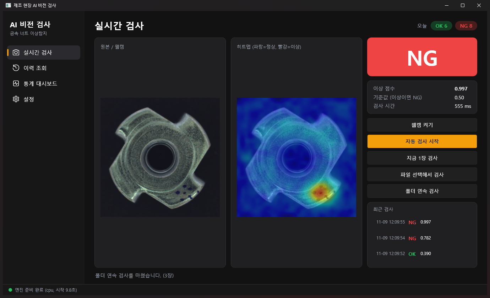
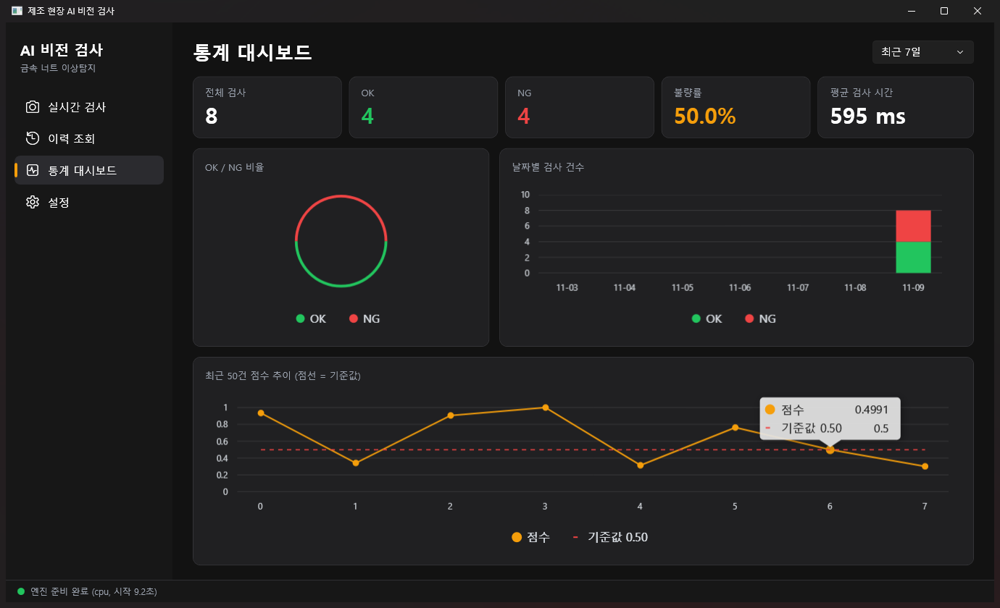
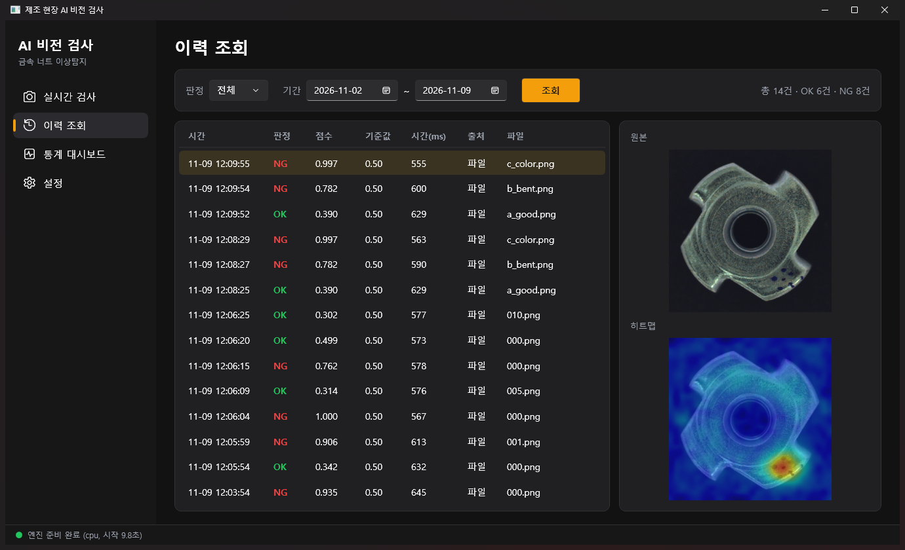
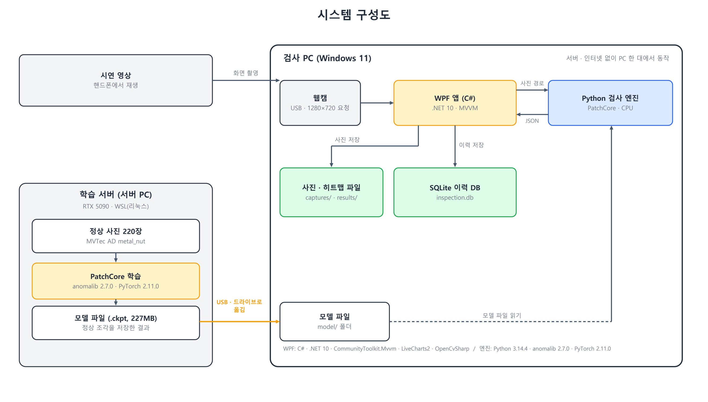

# AI 비전 검사 프로그램 — 금속 너트 이상탐지

카메라(웹캠)로 찍은 **금속 너트 사진을 AI가 분석해 정상(OK) / 불량(NG)을 자동 판정**하고, 이상 점수와 불량 위치(히트맵)를 보여 주며, 검사 이력을 저장해 조회·통계로 관리하는 **제조 현장용 AI 비전 검사 프로그램**입니다.

- **모델**: PatchCore 이상탐지 ([anomalib](https://github.com/open-edge-platform/anomalib)) — 불량 사진 없이 **정상 사진만으로 학습**
- **화면**: WPF (C# · .NET 10, MVVM) 4개 화면
- **엔진**: Python 검사 엔진 (WPF 앱이 실행해서 사용)
- **저장**: SQLite 검사 이력
- **개발 기간**: 2026.11.06 ~ 2026.11.11

## 주요 기능

| 기능 | 설명 |
|---|---|
| 실시간 검사 | 웹캠 미리보기, 자동 간격 검사, 파일 1장 검사, 폴더 연속 검사 |
| 판정 | 이상 점수 ≥ 기준값이면 NG (기준값은 설정에서 바로 변경) |
| 결과 표시 | OK/NG, 점수, 히트맵(파랑=정상, 빨강=이상), 검사 시간 |
| 이력 조회 | 판정·기간 검색, 원본·히트맵 보기 |
| 통계 대시보드 | OK/NG 비율, 날짜별 건수, 최근 점수 추이 (LiveCharts2) |
| 웹캠 촬영 영역 | 가운데 정사각형만 잘라 검사 (미리보기에 주황 네모로 표시) |

## 화면

| 실시간 검사 | 통계 대시보드 | 이력 조회 |
|---|---|---|
|  |  |  |

> 화면 속 사진은 MVTec AD 데이터셋의 샘플입니다.

## 동작 방식



1. 개발할 때 **서버에서 정상 사진 220장으로 PatchCore를 한 번 학습**해 모델 파일(.ckpt)을 만듭니다.
2. 검사할 때 WPF 앱이 **Python 엔진을 켜 두고**, 사진 경로 한 줄을 보내면 엔진이 **결과 JSON 한 줄**을 돌려줍니다. (표준 입출력)
3. 앱이 점수를 기준값과 비교해 OK/NG를 판정하고, SQLite에 저장한 뒤 화면에 보여 줍니다.

자세한 흐름은 [프로그램 흐름 설계도](docs/images/program_flow.png)를 참고하세요.

## 성능

| 항목 | 결과 |
|---|---|
| 서버 평가 (학습에 쓰지 않은 test 115장: 정상 22 + 불량 93) | image_AUROC **0.9976**, image_F1 **0.989**, pixel_AUROC 0.987 |
| 검사 속도 (CPU) | 사진 한 장 약 0.6~0.8초, 엔진 시작 약 10초 (처음 켤 때 한 번) |
| 웹캠 시연 (21장 영상, 기준값 0.95) | 54건 전부 정답 ※ 시연용으로 고른 사진이라 모델 성능을 대표하지 않음 |

## 프로젝트 구조

```
.
├─ app/VisionInspector/     WPF 앱 (Models · Services · ViewModels · Views)
├─ engine/                  Python 검사 엔진 (infer_engine.py, requirements.txt)
├─ train/                   서버 학습 코드 (train.py, setup.sh)
├─ model/                   학습된 모델 파일 위치 (저장소에는 포함되지 않음)
├─ data/                    MVTec AD 데이터 위치 (저장소에는 포함되지 않음)
├─ demo/                    시연 정답표 (영상은 용량·라이선스 문제로 제외)
└─ docs/                    개발계획서, DB정의서, 테스트결과서, 사용자매뉴얼, 도식(PNG)
```

## 시작하기

### 필요한 것

- Windows 10/11, [.NET SDK 10](https://dotnet.microsoft.com/download)
- Python **3.14.4** (학습 환경과 같은 버전 권장)
- 학습된 모델 파일 `model/patchcore_metal_nut.ckpt` (아래 참고)
- (선택) USB 웹캠

### 1. 검사 엔진 환경 만들기

```powershell
python -m venv .venv_engine
.venv_engine\Scripts\python -m pip install torch==2.11.0 torchvision==0.26.0 --index-url https://download.pytorch.org/whl/cpu
.venv_engine\Scripts\python -m pip install -r engine\requirements.txt
```

### 2. 모델 파일 넣기

학습된 모델(`patchcore_metal_nut.ckpt`, 약 227MB)은 GitHub 파일 크기 제한(100MB) 때문에 저장소에 포함하지 않았습니다.
`model/` 폴더에 넣어 주세요. 직접 학습하려면 아래 [학습](#학습-선택)을 따릅니다. 자세한 안내는 [model/README.md](model/README.md).

### 3. 실행

```powershell
cd app\VisionInspector
dotnet run
```

창 아래 상태 표시줄이 **초록색 '엔진 준비 완료'** 가 되면 검사할 수 있습니다. (약 10초, 설치 직후 첫 실행은 몇 분 걸릴 수 있음)

> 앱은 프로젝트 폴더에서 `.venv_engine`의 Python과 `engine/infer_engine.py`를 자동으로 찾습니다. 경로를 바꾸려면 설정 화면에서 수정하세요.

## 학습 (선택)

학습은 **리눅스(WSL)** 환경에서 수행했습니다. (서버 PC RTX 5090)

```bash
cd train
bash setup.sh                 # 가상환경 + PyTorch(GPU) + anomalib 설치
mkdir -p ~/mvtec && cp -r <metal_nut 폴더> ~/mvtec/
source ~/venv_anomalib/bin/activate
python train.py               # 학습 + 평가, ~/model_out/patchcore_metal_nut.ckpt 생성
```

데이터는 [data/README.md](data/README.md)를 참고해 내려받습니다.

## 웹캠 시연

모니터·핸드폰에 너트 사진 영상을 틀고 웹캠으로 다시 찍어 검사하는 시연을 만들었습니다.

- 화면을 다시 찍으면 정상 사진도 점수가 올라가므로 **기준값을 0.95 안팎**으로 올립니다. (원본 사진 검사는 0.5 안팎)
- **어두운 방, 낮춘 모니터 밝기, 웹캠 고정**, 주황 네모에 사진을 꽉 채웁니다.
- 자동 검사 간격 2초 (사진 한 장당 5초 영상 기준)
- 웹캠이 없으면 **[폴더 연속 검사]** 로 대신할 수 있습니다.

자세한 순서는 [사용자 매뉴얼](docs/사용자매뉴얼.hwpx)의 6장을 참고하세요.

## 문서

| 문서 | 위치 |
|---|---|
| 개발계획서 | [docs/개발계획서.hwpx](docs/개발계획서.hwpx) |
| 요구사항 분석서 | [docs/요구사항분석서.hwpx](docs/요구사항분석서.hwpx) |
| 개발 일정표 | [docs/개발일정표.hwpx](docs/개발일정표.hwpx) |
| 프로그램 흐름도 | [docs/프로그램흐름도.png](docs/프로그램흐름도.png) |
| DB 정의서 · ERD | [docs/DB정의서.hwpx](docs/DB정의서.hwpx), [erd.png](docs/images/erd.png) |
| 테스트 결과서 | [docs/테스트결과서.hwpx](docs/테스트결과서.hwpx) |
| 사용자 매뉴얼 | [docs/사용자매뉴얼.hwpx](docs/사용자매뉴얼.hwpx) |
| 제작 과정 설명서 | [docs/vision_inspection_build_guide.pdf](docs/vision_inspection_build_guide.pdf) |
| 일정표 / 프로그램 흐름 / 구성도 | [schedule.png](docs/images/schedule.png) · [program_flow.png](docs/images/program_flow.png) · [architecture.png](docs/images/architecture.png) |

PDF 사본은 `docs/pdf/` 에 있습니다.

## 데이터베이스

SQLite 파일 `inspection.db` 한 개, 표는 `inspections` 1개입니다. (검사 1건 = 1행, 사진은 파일로 저장하고 경로만 기록)
컬럼과 쿼리는 [DB 정의서](docs/DB정의서.hwpx)를 참고하세요.

## 알려진 한계

- **학습한 너트와 비슷한 촬영 조건 전용 모델**입니다. 다른 제품·조명은 재학습과 기준값 조정이 필요합니다.
- **긁힘(scratch)** 같은 작은 불량은 놓칠 수 있습니다.
- 너트가 없는 장면도 NG(1.000)로 나옵니다. (물체 유무 구분 기능 없음)
- 영상 사진이 바뀌는 순간의 프레임이 찍히면 정상이 NG로 나올 수 있습니다. (드묾)
- 시연 영상은 시연용으로 고른 사진이라 **시연 정답률은 모델 정확도를 대표하지 않습니다.**

개선 과제: 물체 유무 검사, '화면이 안정된 때만 검사', GPU/ONNX 가속, 다른 제품 재학습.

## 개발 환경

| 구분 | 버전 |
|---|---|
| Python | 3.14.4 |
| anomalib / PyTorch / lightning | 2.7.0 / 2.11.0 / 2.6.6 |
| .NET | 10 (net10.0-windows10.0.19041.0) |
| WPF 라이브러리 | CommunityToolkit.Mvvm 8.4.2, LiveChartsCore.SkiaSharpView.WPF 2.1.0-dev-798, OpenCvSharp4 4.13, Microsoft.Data.Sqlite 10.0.14 |

## 데이터셋과 출처

- 데이터: **MVTec AD** — metal_nut (정상 학습 220장, 평가 115장). 라이선스 **CC BY-NC-SA 4.0** (비상업적 사용, 출처 표기).
  - Bergmann et al., *MVTec AD — A Comprehensive Real-World Dataset for Unsupervised Anomaly Detection*, CVPR 2019.
- 모델: **PatchCore**
  - Roth et al., *Towards Total Recall in Industrial Anomaly Detection*, CVPR 2022.
- 구현: [anomalib](https://github.com/open-edge-platform/anomalib)

> 논문 제목·연도는 제출 전에 한 번 더 확인하세요.
